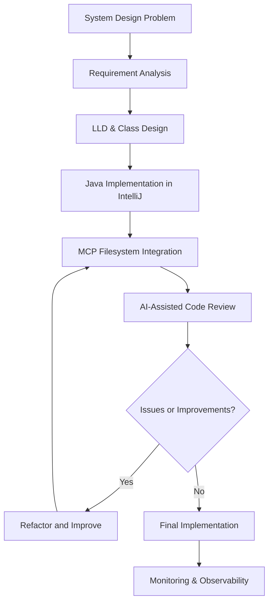

## AI-Assisted System Design Practice & Development Workflow

### Overview

This repository is my hands-on workspace for practicing Low-Level Design (LLD), Object-Oriented Design, Design Patterns, and System Design using Java.

While practicing system design problems, I wanted to build a workflow where I could get AI-assisted coding, code reviews, design validation, and debugging support without depending on paid IDE AI features.

I use IntelliJ IDEA Community Edition for development, which does not provide the built-in AI coding assistant capabilities available in paid IDE offerings. To overcome this limitation, I integrated the **Model Context Protocol (MCP)** with a filesystem server, enabling an AI assistant to interact with my local project files.

The goal is to make AI assistance available directly within my development workflow, helping me analyze my implementations, identify design flaws, validate solutions, and continuously improve code quality.

### Use Case & Motivation

Writing code is only one part of solving a system design problem. I also need to evaluate whether my implementation is correct, maintainable, extensible, and aligned with object-oriented design principles.

This workflow enables me to:

- Practice real-world LLD problems using Java.
- Get AI-assisted code reviews without manually copying and pasting source files.
- Validate implementations against requirements and expected behavior.
- Identify logical errors, edge cases, and design flaws.
- Evaluate SOLID principles and design pattern usage.
- Improve class structure, abstractions, and separation of responsibilities.
- Understand alternative design approaches and trade-offs.
- Explore monitoring and observability alongside system design.

### AI Integration Using MCP (Model Context Protocol)

I implemented the **Model Context Protocol (MCP)** using a filesystem server to connect AI tools with my local system design repository.

This allows the AI assistant to work with project files, subject to the configured filesystem permissions, and provides contextual assistance based on the actual implementation rather than isolated code snippets.

#### Capabilities

- **File Reading:** Read and analyze Java classes, interfaces, implementations, and configurations.
- **File Writing:** Create or update source files and documentation when authorized.
- **Project Analysis:** Understand project structure, class relationships, and design responsibilities.
- **Code Review:** Identify potential bugs, code smells, and design issues.
- **Design Validation:** Review implementations against requirements and expected behavior.
- **Refactoring Suggestions:** Improve code structure, readability, extensibility, and maintainability.
- **Debugging Assistance:** Analyze errors, investigate root causes, and identify edge cases.
- **Learning Assistance:** Explain design decisions, patterns, trade-offs, and alternative implementations.

The primary advantage of this integration is that I can leverage AI assistance with IntelliJ IDEA Community Edition without purchasing an IDE license solely for AI coding capabilities, using compatible AI tools and their available free tiers.

### Development Workflow

### Monitoring & Observability

Alongside design and implementation, I have incorporated monitoring and observability-related configurations to explore how applications and systems can be monitored and evaluated beyond code correctness.

This helps me understand:

- Metrics collection and monitoring.
- Application and system health.
- Performance visibility.
- Identifying bottlenecks and potential issues.
- Operational insights into system behavior.
- The importance of observability in distributed systems.

### Before vs. After Implementation — Impact Evaluation

The following matrix highlights the expected improvements from introducing MCP-based AI assistance and monitoring into my system design practice.

> Note: Percentage improvements are estimated potential impacts, not benchmarked measurements. They are included to illustrate the expected benefits of the workflow.

| Evaluation Metric | Before Implementation | After Implementation | Expected Impact |
|---|---|---|
| Code Context Sharing | Manually copy/paste source files into AI tools | AI can access permitted project files through MCP | 40–60% less context-sharing overhead |
| Code Review | Primarily manual self-review | AI-assisted review of classes, logic, and implementation | 30–50% faster initial review |
| Design Validation | Manually evaluate design against requirements | AI assists in validating design decisions and identifying gaps | Faster identification of design flaws |
| Debugging | Manually trace logic and investigate errors | AI can analyze relevant files and assist with root-cause investigation | 20–40% faster debugging investigation |
| Learning & Feedback | Search concepts and solutions independently | Context-aware feedback based on actual implementation | Faster learning and iteration |
| Project Analysis | Inspect files and classes individually | AI can explore related files and project structure | Reduced manual analysis |
| Development Workflow | Switch between IDE, files, and external AI tools | IDE-focused workflow with contextual AI assistance | Reduced workflow friction |
| Code Quality | Self-review with limited feedback | AI-assisted feedback on SOLID, patterns, readability, and maintainability | Improved design quality |
| Monitoring & Observability | Limited exposure to monitoring configurations | Monitoring and observability experimentation | Better understanding of system health and metrics |
| Iteration & Refactoring | Implement and move to the next problem | Review, refine, refactor, and iterate | More structured development process |

### Key Outcomes

- Built a cost-effective AI-assisted system design practice environment.
- Integrated AI tools with the local development environment using MCP.
- Reduced the overhead of manually sharing code context with AI.
- Established a repeatable AI-assisted code review and debugging workflow.
- Improved the learning feedback loop through implementation-aware reviews.
- Combined LLD practice with monitoring and observability concepts.
- Used AI as a learning and review assistant rather than a replacement for design and implementation.

### My Approach to Solving LLD Problems

1. Analyze the requirements and identify functional constraints.
2. Identify entities, responsibilities, relationships, and abstractions.
3. Design the class structure and interactions.
4. Implement the solution in Java.
5. Use MCP to provide relevant project context to AI.
6. Review the solution for correctness, SOLID principles, design patterns, and edge cases.
7. Refactor based on review findings.
8. Explore monitoring and observability where applicable.
9. Document learnings and trade-offs.

---

This repository is continuously evolving as I practice new design problems, explore architectural approaches, and improve my software engineering skills.

