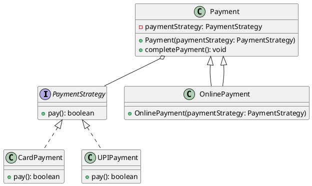

# Low-Level Code Judgement

This document is used to evaluate the quality of the low-level code in this directory.

## Criteria

| Category | Rating (1-5) | Comments |
| :--- | :--- | :--- |
| **Clarity and Readability** | | Is the code easy to understand? |
| **Correctness** | | Does the code do what it's supposed to do? |
| **Efficiency** | | Is the code performant? |
| **Maintainability** | | Is the code easy to modify and debug? |
| **Adherence to Coding Standards** | | Does the code follow the project's coding standards? |

## Architecture Diagram

